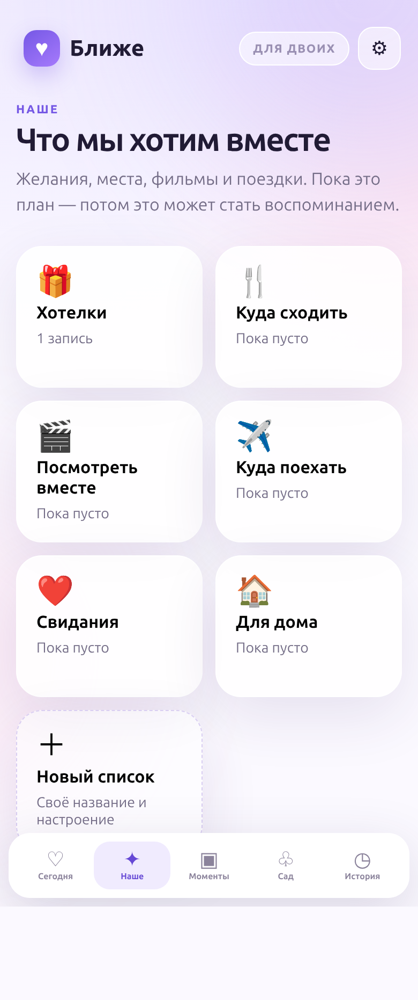
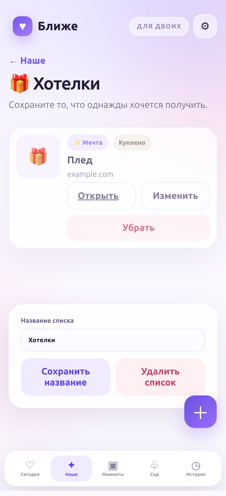
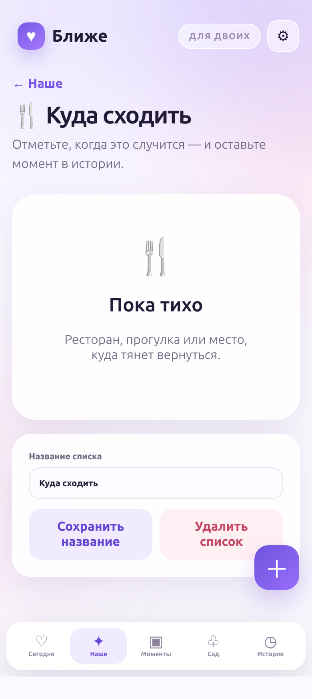
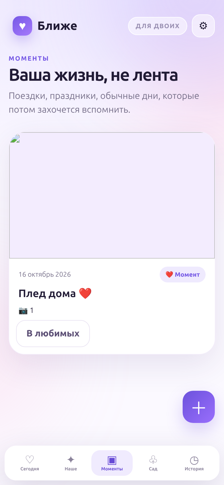
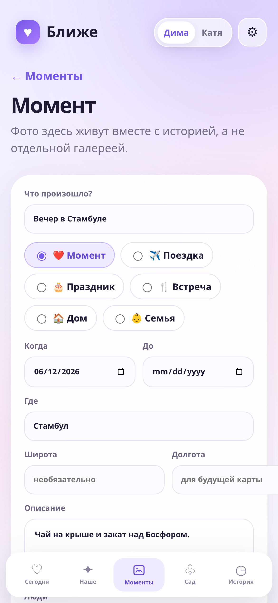
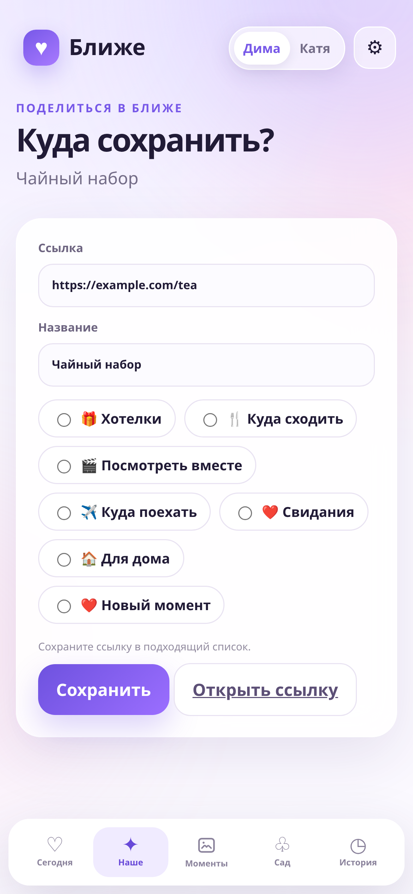
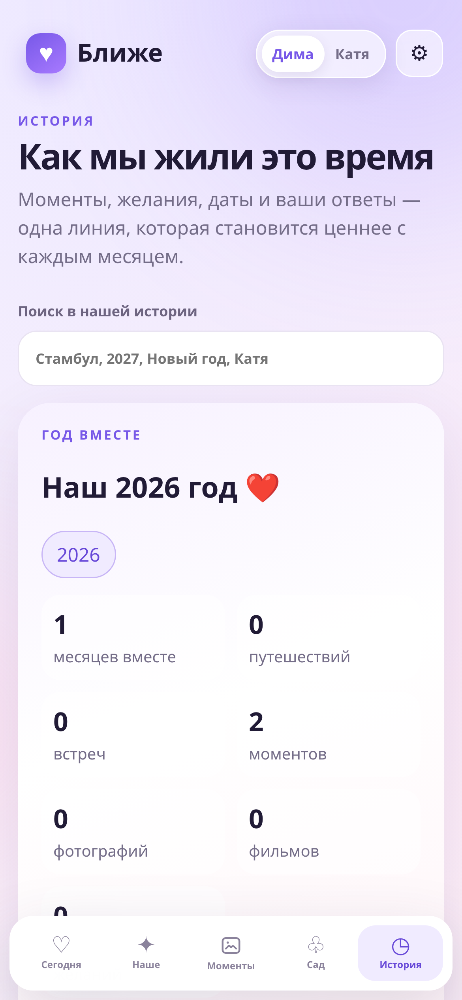
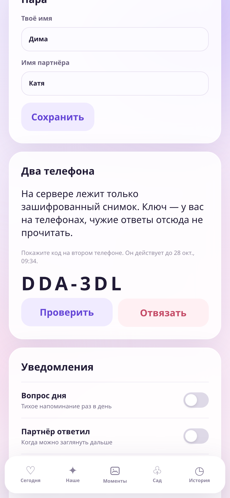

# Ближе / Nearer

Совместный архив пары: вопрос дня, списки и вишлисты, моменты, сад, история.  
**Live:** [https://nearer.other.dev-regiuslab.by/](https://nearer.other.dev-regiuslab.by/)

Local-first PWA (+ Capacitor Android/iOS). Данные живут на телефоне; между двумя телефонами — **end-to-end синхронизация** (сервер видит только ciphertext).

## Принцип работы

```
Телефон A                          Сервер (тонкий)                     Телефон B
─────────                          ───────────────                     ─────────
IndexedDB                          pairing codes (hash)                IndexedDB
ответы / списки / моменты    ←→    ECDH public keys              ←→    то же
                                   encrypted sync blob
                                   (AES-GCM, без plaintext)
```

1. **Локально.** Всё пишется в IndexedDB на устройстве. Offline работает без сервера.
2. **Связка.** Один создаёт код → второй вводит код (Настройки → «Два телефона»). Каждый телефон генерирует ECDH-ключ; общий AES-ключ выводится на устройствах.
3. **Синхронизация.** После связи ответы, списки, вишлисты, моменты и сад уходят на сервер **зашифрованными**. Расшифровка — только на телефонах пары. Demo Partner на linked-паре отключён.
4. **Превью ссылок.** Отдельный endpoint тянет Open Graph / JSON-LD для вишлиста (без хранения ваших списков в plaintext).
5. **Бэкап.** Настройки → файл-копия (секрет связи в файл не попадает). Нужен при смене телефона / очистке данных браузера.

Сервер **не** является основной БД пары и не читает содержимое архива.

## Скриншоты (мобильная вёрстка)

Актуальные кадры ~390×844 (папка `docs/screenshots/new/`).

| Наше | Хотелки | Куда сходить | Моменты |
|:---:|:---:|:---:|:---:|
|  |  |  |  |

| Момент | Поделиться | История | Связь телефонов |
|:---:|:---:|:---:|:---:|
|  |  |  |  |

Ритуал «Сегодня» / сад / онбординг (ранние кадры): `docs/screenshots/01-…08-…`.

## Быстрый старт (web)

```bash
npm install
npm run dev          # http://127.0.0.1:4173
npm run build        # → pwa/www/
npm test
```

## Деплой

Продакшен-домен: **`nearer.other.dev-regiuslab.by`** (Caddy → `127.0.0.1:3011`).

```bash
cp .env.example .env
# DOMAIN=nearer.other.dev-regiuslab.by
# APP_PORT=3011
docker compose -p nearer up -d --build
```

Стек: nginx (PWA) + `link-preview` (pairing + E2E sync blob + link preview).  
Подробности, изоляция на regiuslab-de, CI/CD: **[docs/deploy.md](docs/deploy.md)**.

Клиенту: открыть HTTPS → Android Chrome «Установить» / iOS Safari «На экран Домой».

## Структура

```
pwa/                 # Vite PWA → pwa/www
  domain/            # списки, моменты, sync merge, schema
  platform/link/     # pairClient, ECDH/AES crypto
  components/        # UI вкладок
server/              # pairing + opaque sync + link-preview
docs/screenshots/    # мобильные кадры
```

## Версии

| | |
|--|--|
| App | 0.1.0 |
| Capacitor | 8.5.2 |
| Node (build) | ≥ 20 (CI), предпочтительно 22+ |
| appId | `app.blizhe.couple` (hypothesis) |

## Android / iOS

```bash
npm run cap:sync:android && npm run android:build:debug
npm run cap:sync:ios && npm run ios   # macOS
```

APK: `artifacts/`. iOS: `docs/IOS_TESTING.md`. Подпись: `signing/` gitignored.

## Storage и уведомления

- IndexedDB `blizhe-pwa` — основной store; переживает kill процесса, **не** переживает удаление PWA / очистку сайта.
- Уведомления: Web Notifications / Capacitor Local Notifications; daily reminder в настройках.

## Test Lab

Настройки → «О приложении» → 7 тапов по версии (или long-press логотипа).

## Docs

- [docs/deploy.md](docs/deploy.md) — Docker, TLS, CI/CD, порт 3011
- [docs/USER_TEST_RU.md](docs/USER_TEST_RU.md)
- [docs/HYPOTHESIS.md](docs/HYPOTHESIS.md)
- [docs/KNOWN_LIMITATIONS.md](docs/KNOWN_LIMITATIONS.md)
