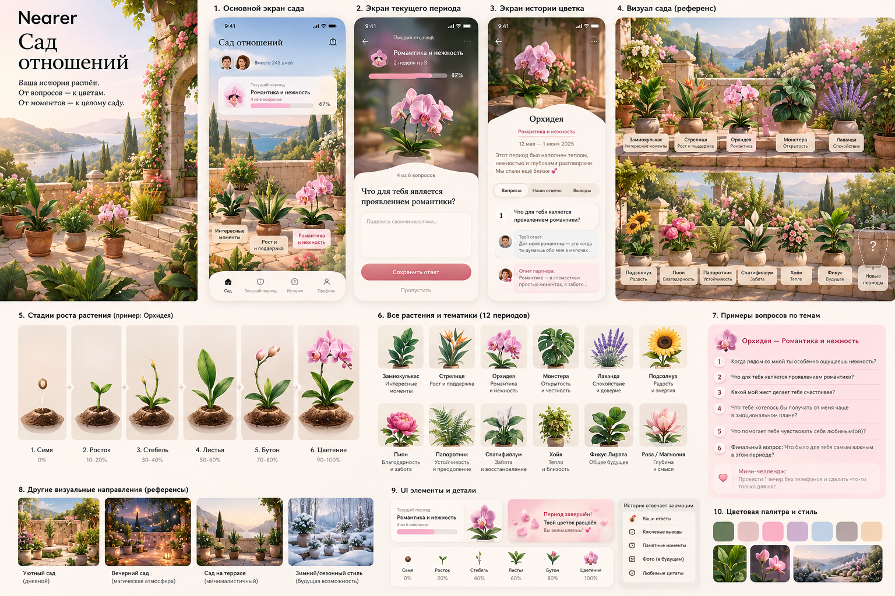
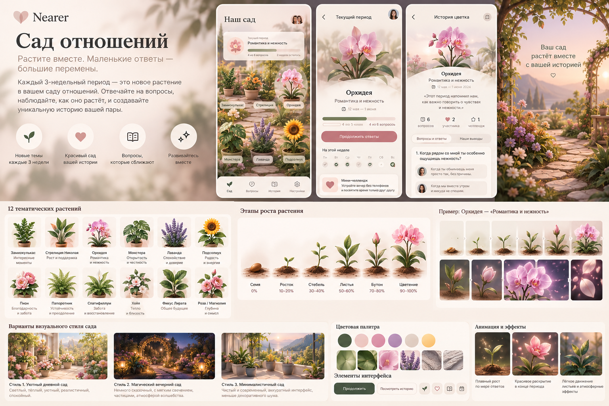
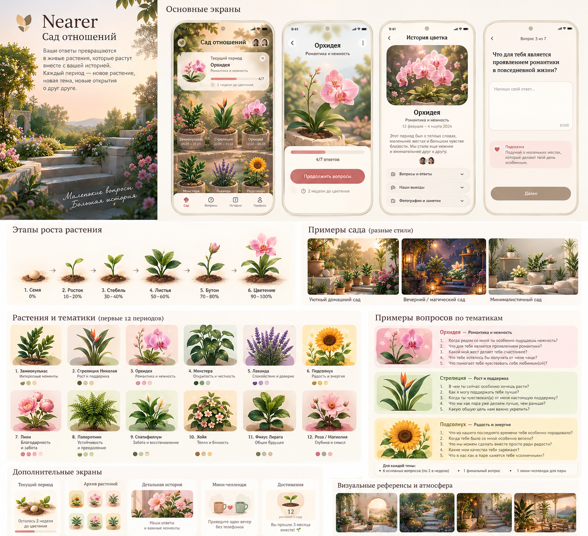

# Nearer — роудмап к продакшену и монетизации

**Версия:** 1.0 · **Дата:** 2026-10-22  
**Live:** https://nearer.other.dev-regiuslab.by/  
**Исходный концепт:** `Nearer_Garden_of_Relationships_Concept.docx` (визуалы в `docs/roadmap/assets/`)

---

## 0. Executive summary (для инвестора)

**Nearer («Ближе»)** — private shared-life app для пары: совместный ритуал вопросов, списки желаний, моменты и **визуальный «Сад отношений»**, который растёт от совместных ответов.

**Дифференциатор не «ещё один чат»**, а:
1. **Эмоциональный артефакт** — сад как память отношений (не лента сообщений).
2. **Privacy by design** — E2E-шифрование синка; сервер не читает ответы и списки.
3. **Двусторонний ритуал** — ценность появляется только когда отвечают оба.

**Сейчас (гипотеза → soft prod):** PWA на проде, local-first IndexedDB, pairing + encrypted sync, архив списков/моментов, демо-paywall «Плюс».

**Цель 12 месяцев:** стабильный retention у пар (D7/D30), платящая подписка Couple Plus, магазины (или сильный PWA), понятная unit-экономика для seed-раунда.

| North star | Метрика |
|---|---|
| Пара возвращается вместе | % пар с ≥2 mutual reveals / неделю |
| Сад становится дорогим | % пар с ≥1 завершённым растением (периодом) |
| Платят за память и глубину | Trial → paid conversion ≥ 8–15% |

---

## 1. Что уже есть vs концепт «Сад отношений»

### 1.1 Текущий продукт (факт)

| Слой | Состояние |
|---|---|
| Ритуал «вопрос дня» | Есть (календарный день, reveal, реакция, streak) |
| Сад | Упрощённый: **одно** растение/стадии от `completedDays` (emoji-stages) |
| Архив пары | Списки, вишлист, места, моменты, история, share inbox |
| Два телефона | Pairing + **E2E sync** (ECDH → AES-GCM ciphertext на сервере) |
| Монетизация | Soft paywall «Ближе Плюс» (demo flag, без биллинга) |
| Деплой | Docker + CI/CD, домен `nearer.other.dev-regiuslab.by` |

### 1.2 Концепт из документа (цель)

| Идея концепта | Суть |
|---|---|
| 1 период = 3 недели = 1 тема = 1 растение | Замиокулькас… Роза/Магнолия (12 тем) |
| Рост: семя → росток → стебель → листья → бутон → цветение | Прогресс от **взаимных** ответов |
| Экран сада = терраса с 10–12 растениями | Активное выделено, завершённые остаются |
| История цветка | Тема, даты, Q&A обоих, выводы, позже фото/AI |
| MVP vs Later | Сад + периоды сейчас; AI/сезоны/PDF/ambient — позже |

### 1.3 Разрыв (gap)

Концепт описывает **сезонный narrative loop** (3 недели → цветок в саду).  
Текущий код — **daily loop** + один агрегированный сад.  
Архив (списки/моменты) уже сильнее, чем в концепт-MVP — это плюс для «shared life», его надо **встроить в историю цветка**, а не конкурировать с садом.

**Прод-уровень предложение:** не выкидывать daily, а сделать двухуровневую модель:

```
Daily pulse  →  «Сегодня» (привычка, 2–5 мин)
Period arc   →  «Сад» / текущее растение (глубина, 3 недели)
Life archive →  «Наше» / «Моменты» (желания → воспоминания)
```

Так продукт одновременно удерживает (daily) и создаёт коллекционную ценность (сад) — это лучше для retention и для питча инвесторам, чем только одно из двух.

---

## 2. Продвинутая продуктовая модель (рекомендация)

### 2.1 Ценностные петли

1. **Habit loop:** уведомление → ответ → ожидание партнёра → reveal → микро-реакция → рост активного растения.
2. **Collection loop:** завершение периода → анимация цветения → растение в саду → «История цветка» → желание начать следующий.
3. **Archive loop:** wishlist / места → «купили / сходили» → момент с фото → таймлайн отношений.
4. **Invite loop:** один партнёр → код пары → второй телефон → первая совместная неделя (критический onboarding).

### 2.2 Информационная архитектура (prod IA)

| Tab | Роль | Приоритет |
|---|---|---|
| Сегодня | Daily вопрос + статус пары + мини-прогресс растения | P0 |
| Сад | Терраса, активное растение, пустые горшки | P0 (ребилд) |
| Наше | Списки / вишлист / места | P0 (есть) |
| Моменты | Фото-истории, favorites | P0 (есть) |
| История | Таймлайн + year review + вход в «Историю цветка» | P1 |
| Настройки | Пара, E2E link, backup/recovery, подписка | P0 |

Концепт предлагал nav «Сад / Период / История / Профиль». Для уже живущего продукта лучше **сохранить 5 вкладок**, а «Текущий период» сделать первым экраном внутри **Сада** (hero активного растения), чтобы не ломать привычку тестеров.

### 2.3 Модель данных (prod, поверх текущего schema)

```
CoupleCircle
  circleId, linkedAt, subscriptionTier

Period
  id, themeId, plantType, startDate, endDate
  status: active | completed | abandoned
  stage, completionPercent
  summary (user or later AI)
  challengeCompleted: bool

Theme / PlantCatalog
  id, name, plantType, palette, questionPackId, challengeIdeas[]

Question
  id, themeId, weekNumber (1–3), order, depth, text

Answer
  periodId?, dayKey?, questionId, role a|b
  text, submittedAt, reaction?

PlantInstance (в саду)
  periodId, visualStage, slotIndex, bloomedAt

List / ListItem / Moment / Media  — уже есть
  + imageUrl на items (уже в модели; нужна UI)
  + link preview → imageUrl

DeviceLink + SyncBlob  — уже есть (E2E)
  + recoveryKey (новый)
```

Миграция: текущий `completedDays` / emoji garden → `Period` «legacy seed» или стартовый период «Интересные моменты».

### 2.4 Privacy & trust (инвесторский и пользовательский must)

Уже заложено правильно. Довести до «prod privacy story»:

| Тема | Решение |
|---|---|
| Сервер не читает контент | Только ciphertext + метаданные пары |
| Смена телефона | Recovery phrase / QR (ключ + последний revision) |
| Backup файл | Уже есть; добавить reminder + encrypt backup passphrase |
| Фото | Preview на устройстве; в sync — URL или маленький preview, не full original |
| AI summary (позже) | Только on-device или opt-in upload decrypted locally → ephemeral API, без хранения |
| Аккаунты | Опциональный «cloud recovery» без обязательного email для MVP; для сторов — Sign in with Apple/Google как recovery shell, не как источник правды данных |

**Позиционирование:** «Ваш сад отношений хранится у вас. Мы помогаем синхронизировать телефоны, не читая дневник».

---

## 3. Визуал и UX: от референсов к прод-системе

Референсы концепта (`assets/image1–3.png`): cozy botanical terrace, Mediterranean light, soft magical evening, clean mobile cards.

### 3.1 Design system (prod)

- **Brand:** сердце + ботаника; hero — название «Ближе», не конкурентный UI-kit.
- **Палитра:** тёплый stone + sage + orchid blush (избегать «дефолтного AI purple-on-white» как единственного языка; текущий soft-lilac допустим как база, но сад должен давать **натуральный green/soil** контраст).
- **Типографика:** выразительный display для названий растений + читаемый UI sans.
- **Сад:** одна композиция на первый viewport (терраса), не dashboard из карточек.
- **Растения:** дискретные стадии (SVG/Lottie/Rive), не процедурный рост в MVP.
- **Motion:** 2–3 signature animations — рост после mutual answer, bloom finale, idle sway.

### 3.2 Ключевые экраны (UX map)

1. **Сад (home emotion)** — терраса, 12 слотов, активное растение + progress chip периода.
2. **Текущий период** — растение крупно, неделя 1–3, вопрос, статус партнёра, челлендж.
3. **История цветка** — Q&A side-by-side, вывод, мини-челлендж, deep-link в моменты периода.
4. **Сегодня** — короткий daily; если есть активный период, daily вопрос может браться из pack темы (или отдельный «pulse» pack).
5. **Наше / Моменты** — без ломки; визуально рифмовать с садом (те же materials).

### 3.3 Контент: 12 растений (зафиксировать как v1 catalog)

| # | Растение | Тема |
|---|---|---|
| 1 | Замиокулькас | Интересные моменты |
| 2 | Стрелиция | Рост и поддержка |
| 3 | Орхидея | Романтика и нежность |
| 4 | Монстера | Открытость и честность |
| 5 | Лаванда | Спокойствие и доверие |
| 6 | Подсолнух | Радость и энергия |
| 7 | Пион | Благодарность и забота |
| 8 | Папоротник | Устойчивость и преодоление |
| 9 | Спатифиллум | Забота и восстановление |
| 10 | Хойя | Тепло и близость |
| 11 | Фикус лирата | Общее будущее |
| 12 | Роза / Магнолия | Глубина и смысл |

**Период:** 3 недели · ~6 вопросов + финал + мини-челлендж · рост только от **взаимных** ответов (оба роли), иначе «waiting» честно.

---

## 4. Монетизация (чтобы платили и это было этично)

### 4.1 Принцип

Платят за **глубину памяти и эстетику**, не за базовую связь.  
Базовая пара должна чувствовать пользу free forever (иначе churn и плохие отзывы).

### 4.2 Пакеты

| Tier | Цена (ориентир RU/CIS) | Что входит |
|---|---|---|
| **Free** | 0 | 1 активный период, первые 3–4 растения, daily, списки, моменты (лимит фото), E2E sync, 30 дней истории Q&A |
| **Couple Plus** (подписка) | ~299–449 ₽ / мес или ~1990–2990 ₽ / год | Все 12+ растений, полный сад, полная история, year review, memory PDF, больше фото, сезонные фоны, priority themes |
| **Lifetime / Gift** (позже) | one-time | Подарочная подписка паре, «юбилейный» special plant |

### 4.3 Что НЕ monetize агрессивно

- Саму возможность связать телефоны  
- Базовый daily reveal  
- Safety / backup / E2E  

Иначе разрушается trust narrative.

### 4.4 Технический биллинг

1. **PWA сейчас:** Soft paywall + промокоды / ручной Plus; Stripe/CloudPayments для web (если юрлицо).  
2. **Stores:** RevenueCat + App Store / Google Play subscriptions (обязательно для IAP).  
3. Entitlement abstraction уже есть (`DemoEntitlementProvider` → `RevenueCatProvider`).

### 4.5 Unit-экономика (простая модель для питча)

Допущения для планирования (не forecast):

- CAC organic (контент/сарафан) + paid later  
- Trial 7 дней Plus после первого bloom  
- Target: LTV ≥ 3× CAC; payback < 3 мес на paid каналах  

Ключевые рычаги LTV: **завершение первого цветка** и **второй партнёр активирован в D3**.

---

## 5. Роудмап (фазы)

### Фаза 0 — Foundation hardening (2–3 недели) ✅ частично / добить

**Цель:** продукт не теряет данные и реально связывает пару.

- [x] E2E pair sync  
- [ ] Recovery key / restore на новый телефон  
- [ ] Reminder «скачайте копию»  
- [ ] ImageUrl + OG preview в вишлистах/списках (UI)  
- [ ] Push: partner answered / daily (хотя бы web push или Capacitor local надёжно)  
- [ ] Analytics consent + remote funnel (PostHog/Amplitude self-host или privacy-friendly)  
- [ ] Обновить `KNOWN_LIMITATIONS` под факт sync  

**Exit:** пара на двух телефонах 7 дней без потери данных при смене браузера/телефона (с recovery).

---

### Фаза 1 — Garden v2 MVP (4–6 недель)

**Цель:** концепт «Сад отношений» ощущается как продукт, а не emoji-статус.

- Модель Period / Theme / PlantInstance  
- Каталог 8 растений (можно стартовать с 8, API на 12)  
- Экран сада (терраса, слоты, активное)  
- Экран текущего периода + рост от mutual answers  
- История цветка (без AI)  
- Дискретные стадии SVG/Lottie для 1–2 растений, остальные — staged stills  
- Контент: 6+1 вопросов на тему, 1 челлендж  

**Exit:** ≥40% linked пар начинают период; ≥25% доходят до стадии «листья» за 10 дней.

---

### Фаза 2 — Loveable archive + polish (3–4 недели)

**Цель:** «Наше» и «Моменты» усиливают сад.

- Фото в list items (camera/gallery + compress)  
- Связка «купили / сходили» → draft момента с привязкой к periodId  
- Memory highlights в Истории цветка  
- Onboarding для второго партнёра (guided join)  
- Visual polish под design system сада  
- Accessibility, empty states, delightful microcopy  

**Exit:** NPS/качественные отзывы «хотим продолжать»; доля пар с ≥1 моментом и ≥1 wishlist item.

---

### Фаза 3 — Monetization live (3–4 недели)

**Цель:** первые деньги без разрушения trust.

- Free vs Plus entitlements на растения/историю/PDF  
- Soft paywall после первого bloom («сохраните сад»)  
- Web billing **или** store IAP (выбрать GTM: PWA-first vs store-first)  
- Promo codes для инфлюенсеров  
- Legal: оферта, privacy, GDPR/152-ФЗ черновик  

**Exit:** первые 50–200 trials; conversion tracking; churn причины записаны.

---

### Фаза 4 — Scale & stores (6–10 недель)

**Цель:** дистрибуция и инвесторский traction.

- Capacitor release Android (Play internal→production)  
- iOS TestFlight → App Store (Sign in with Apple если аккаунт)  
- Remote push FCM/APNs  
- Seasonal garden skins (Plus)  
- Export Memory Book PDF  
- Content ops: редактор тем без релиза приложения  
- Performance, crash-free ≥ 99.5%  

**Exit:** публичные сторы + стабильный WAU пар + понятный MRR.

---

### Фаза 5 — Differentiation (после product-market fit)

- On-device / opt-in AI period summary  
- Ambient sound / evening garden mode  
- Special event plants (годовщина)  
- Family/close-friends circle (осторожно — не размывать «для двоих»)  
- B2B: therapists / retreats (white-label periods) — опциональный later bet  

---

## 6. Технический роудмап (архитектура)

### 6.1 Принципы

1. **Local-first truth** в IndexedDB.  
2. **Sync = encrypted snapshot / CRDT-lite merge** (уже LWW entities).  
3. **UI не знает** про storage backend (`CoupleRepository`).  
4. **Thin server:** pairing, sync blob, link-preview, (позже) push fanout, billing webhooks.  
5. **Нет plaintext couple DB** на сервере — это и compliance, и маркетинг.

### 6.2 Эволюция sync (prod-grade)

| Сейчас | Следующий шаг | Цель |
|---|---|---|
| Full encrypted state blob | Chunked collections + media manifest | Меньше конфликтов, фото |
| Revision optimistic lock | Per-collection revisions | Меньше 409 retry storms |
| ECDH on pair | + recovery key wrapping sync key | Смена устройства |
| — | Optional relay for large media (encrypted objects) | Фото без раздувания blob |

### 6.3 Клиент

- Оставить vanilla/Vite PWA как ядро (быстрые итерации) **или** постепенно выделить `domain/` + тонкий UI; полный React не обязателен для PMF.  
- Garden visuals: Rive/Lottie пакеты по `plantType`.  
- Feature flags для тем и paywall.

### 6.4 Наблюдаемость

- Client funnel events (уже зачатки analytics) → privacy-safe remote  
- Server: pair create/join/sync rates, error codes, latency (без payload)  
- Business: linked pairs, bloom rate, trial start, paid convert  

---

## 7. GTM и привлечение внимания инвесторов

### 7.1 Narrative (30 секунд)

> «Nearer превращает ежедневную близость пары в сад, который растёт только когда отвечают оба. Данные зашифрованы end-to-end — мы не читаем дневник отношений. Пары платят за полную память и новые растения, а не за сам факт переписки.»

### 7.2 Доказательства для инвестора (порядок)

1. **Retention пар** (не скачиваний): D7 linked-pair retention  
2. **Emotional proof:** UGC скрины сада (с согласием)  
3. **Waitlist / invite conversion** второго партнёра  
4. **Revenue:** trials → paid  
5. **Privacy moat:** технический design doc E2E  

### 7.3 Каналы

- Органика: Telegram/Instagram «ритуалы для пар», свадебные/relationship creators  
- Gift positioning к 14 февраля / годовщинам  
- Product Hunt / VC demo только после Garden v2 + real sync  
- Партнёрства с психологами (этичный контент вопросов)  

### 7.4 Риски и митигация

| Риск | Митигация |
|---|---|
| Один партнёр бросает | Onboarding #2, soft reminders, ценность solo-режима ограничена честно |
| «Ещё одно wellness app» | Сад как коллекция + archive wishlist→moments |
| Privacy scare | Публичный security one-pager, open design |
| Store fees / IAP | PWA + web sub параллельно где легально |
| Контент выгорает | 12 тем × сезоны × user challenges; редактор контента |

---

## 8. KPI по фазам

| Фаза | Product KPI | Business KPI |
|---|---|---|
| 0 | Sync success ≥ 95%, restore works | — |
| 1 | Period start ≥ 40% linked | Waitlist/referrals |
| 2 | Moment created ≥ 30% pairs | Qualitative «delight» |
| 3 | Trial start ≥ 20% bloomers | First MRR |
| 4 | D30 pair retention ≥ 25% | MRR growth MoM |

---

## 9. Команда и порядок инвестиций (ориентир)

**До seed (сейчас → фаза 3):** 1–2 инженера + дизайн/иллюстрация растений (контракт) + контент вопросов.  
**Seed use of funds:** mobile release, plant art pack, billing, growth experiments, legal.

Не раздувать backend-команду: thin server — сознательный выбор.

---

## 10. Ближайшие 10 шагов (исполняемый backlog)

1. Recovery key для смены телефона.  
2. UI картинок в списках (OG `imageUrl` + upload preview).  
3. Period model + миграция garden.  
4. Каталог 8 тем с вопросами (из концепта).  
5. Экран сада v2 (терраса, слоты).  
6. Рост от mutual answers + bloom finale.  
7. История цветка.  
8. Plus entitlements на растения 5–12.  
9. Billing (web или RevenueCat).  
10. Публичный privacy/security one-pager + обновлённые скрины для стора/инвесторов.

---

## 11. Заключение

Концепт «Сад отношений» — правильный эмоциональный core для Nearer.  
Текущий продукт уже сильнее гипотезы 0.1 за счёт **архива** и **E2E sync**.  

Прод-путь: **не заменить daily архивом или садом**, а связать три петли (pulse / period / archive), монетизировать память и растения, сохранить privacy как бренд.  

Это одновременно:
- полезно парам (ритуал + память),  
- привлекательно визуально (терраса/рост),  
- интересно инвесторам (retention mechanic + trust moat + clear Plus wedge).

---

## Приложение A — визуалы концепта







## Приложение B — связь с репозиторием

| Документ / код | Роль |
|---|---|
| `README.md` | Live URL, принцип E2E |
| `pwa/domain/sync/*` | Encrypted sync |
| `pwa/domain/LocalCoupleRepository.js` | Garden stages (legacy) |
| `server/pairStore.js` | Pairing + ciphertext |
| Этот файл | Prod roadmap |

---

*Документ предназначен для продуктовых решений и питч-подготовки. Цифры цен и KPI — ориентиры для планирования, не финансовый прогноз.*
